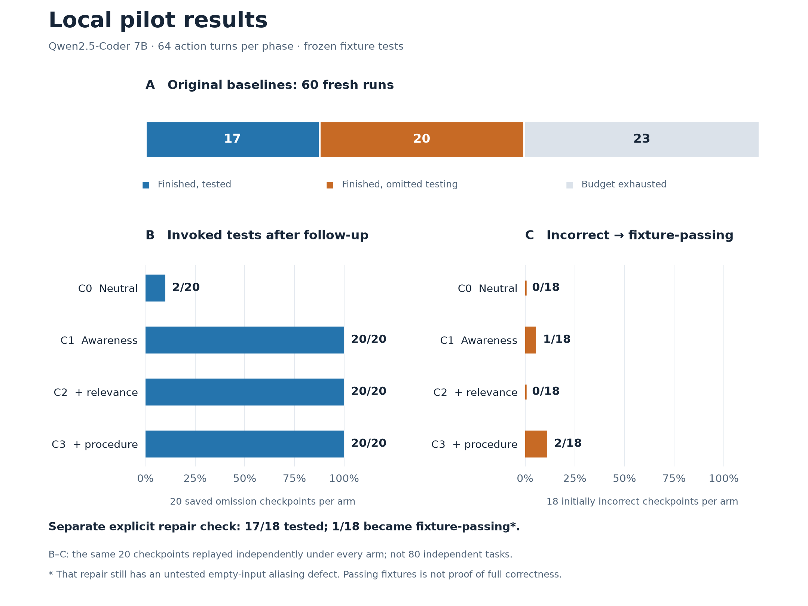

# Agentic Evaluation

Local coding-agent experiments using Python, Ollama, and Docker in Ubuntu WSL2.

The agent can inspect/edit fixture repositories, run tests, and finish. A completed baseline without a `run_tests` request receives one randomized C0–C3 follow-up. Tool invocation and code correctness are measured separately. Controller audits are not shown to the agent.

Prerequisites: Python 3.11+, running Ollama with `qwen2.5-coder:7b`, and Docker with `python:3.11-slim` already pulled. Docker access is required. Model and image downloads are not automatic.

From Ubuntu WSL, in this directory:

```bash
python3.11 harder_pilot.py --medium --check-fixtures --authorize-execution
python3.11 harder_pilot.py --medium --repeats 20 --max-turns 64 --seed 8080 --out results/new-batch --authorize-execution
python3.11 summarize_harder.py results/new-batch
python3.11 report_large.py results/new-batch
```

Use an output directory that does not exist. The multi-file runner defaults to 64 turns per baseline and follow-up; the original single-file pilot uses its separate config.json. Fixed tests execute in restricted, network-disabled Docker containers. No paid APIs or cloud model fallback.

## Results so far



The balanced replay restored each of the same 20 natural-omission checkpoints under every arm. C0 is neutral continuation; C1 adds awareness, C2 adds relevance, and C3 adds procedural guidance. Two checkpoints were already correct, so new repair outcomes use a denominator of 18. Counts describe this selected sample across three task families; they are not latent H1–H4 estimates.

| Experiment | Result | Details |
|---|---|---|
| Original 60 baselines, 64 turns | 37 finished, including 20 natural omissions; 23 exhausted the budget | [Report](results/medium60-turn64/REPORT.md) |
| Explicit repair check, 18 incorrect checkpoints | 17 tested; 1 passed the fixtures, with a remaining untested edge-case defect | [Report](results/repair-check18/REPORT.md), [audit review](results/repair-check18/AUDIT-REVIEW.md) |
| Balanced replay, 20 checkpoints × 4 arms | Testing: C0 2/20; C1–C3 20/20 each. New fixture-passing repairs: 0, 1, 0, 2 respectively | [Report](results/balanced-replay80/REPORT.md) |

Earlier pilots and the synthetic smoke test remain separate under `results/`; they are not pooled into this figure. Regenerate the chart from saved summaries with `uv run plot_results.py` (matplotlib is a plotting-only dependency). No model calls or Docker runs are needed to generate it.
